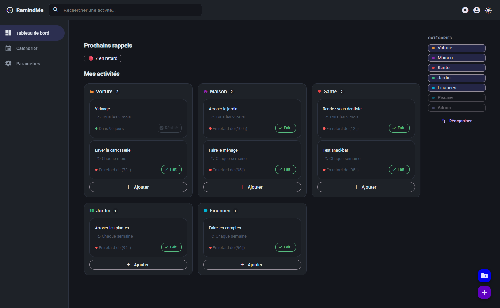
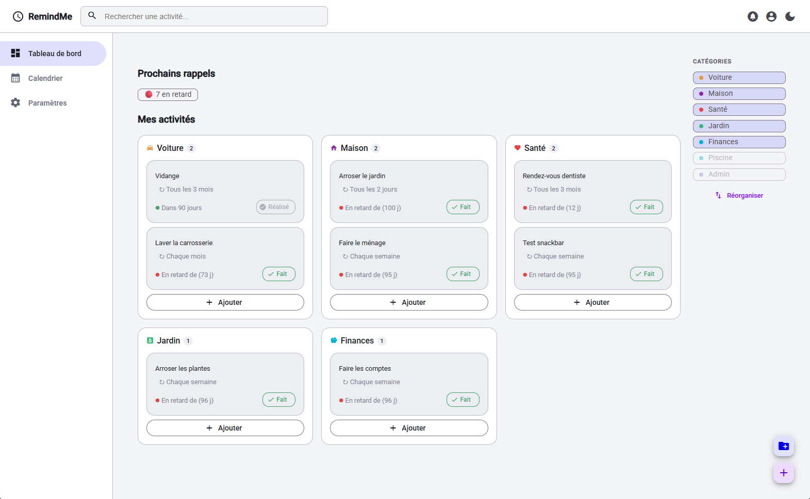

[🇫🇷 Français](README.md) | 🇬🇧 English

# RemindMe

<!--  -->


> A PWA for tracking daily life activities with cyclical reminders — garden, pool, pets, health, and more.

---

<!-- Replace with a screenshot or GIF of the dashboard -->




---

## Features

- **Dashboard** — category overview with visual status for each activity (up to date, due soon, overdue)
- **Cyclical reminders** — configurable repeat cycle per activity (1d, 3d, 7d, 14d, 30d…)
- **Calendar view** — visual activity tracking over time with color-coded status
- **System notifications** — native alerts on startup via the Web Notifications API
- **Light / dark themes** — dynamic switching, preference persisted
- **Offline mode** — fully usable without a connection (Service Worker)
- **Installable** — PWA installable on desktop (Windows / macOS) and mobile (Android / iOS)
- **Export / Import** — data backup and restore in JSON format

---

## Tech Stack

| Layer         | Technology                                       |
| ------------- | ------------------------------------------------ |
| Framework     | Angular 17+ — Standalone Components, Signals     |
| UI            | Angular Material Design 3                        |
| Language      | TypeScript 5.x                                   |
| Storage       | IndexedDB via Dexie.js                           |
| Styles        | SCSS + CSS Custom Properties                     |
| PWA           | @angular/pwa — Service Worker + Web App Manifest |
| Notifications | Web Notifications API                            |
| Bundler       | ESBuild                                          |
| Quality       | ESLint, Jasmine, GitHub Actions CI               |
| Accessibility | RGAA 4.1.2                                       |

---

## Architecture

**Feature-based** organisation with **Standalone Components** (Angular 17+).

```
src/app/
├── core/               # Singleton services, models, Dexie base
│   ├── db/             # IndexedDB definition (AppDatabase)
│   ├── models/         # TypeScript interfaces (Category, Activity, User)
│   └── services/       # ActivityService, ThemeService, NotificationService…
├── features/           # Isolated business features
│   ├── dashboard/      # Main screen (Smart component)
│   ├── calendar/       # Calendar view
│   ├── categories/     # Category management
│   └── settings/       # Profile and settings
├── layout/             # Visual shell (Header, Sidebar, BottomNav)
└── shared/             # Reusable components, pipes and directives
```

**Applied patterns**

- **Smart / Dumb components** — separation of business logic and presentation
- **Lazy-loaded routes** — on-demand loading for better PWA performance
- **Angular Signals** — modern reactivity without RxJS boilerplate
- **Dexie.js versioning** — IndexedDB schema migrations handled cleanly

---

## Getting Started

### Prerequisites

- [Node.js](https://nodejs.org) v20 or v22 (LTS)
- [Angular CLI](https://angular.dev/tools/cli) v17+

```bash
npm install -g @angular/cli
```

### Installation

```bash
# Clone the repo
git clone https://github.com/Mickael-Sache/RemindMe.git
cd RemindMe

# Install dependencies
npm install

# Start in development mode
ng serve
```

The app is available at [http://localhost:4200](http://localhost:4200)

### Production Build

```bash
ng build --configuration=production
```

Compiled files are generated in `dist/remindme/browser/`.

> The Service Worker is only active in production mode. To test offline mode locally:
>
> ```bash
> npx serve dist/remindme/browser
> ```

### Tests

```bash
# Unit tests
ng test

# Linting
ng lint
```

---

## CI Pipeline

Every push to `main` or `develop` automatically triggers:

| Step             | Command                                           |
| ---------------- | ------------------------------------------------- |
| Install          | `npm ci`                                          |
| Lint             | `ng lint`                                         |
| Unit tests       | `ng test --watch=false --browsers=ChromeHeadless` |
| Production build | `ng build --configuration=production`             |

---

## Roadmap

- [x] Dashboard with activity status
- [x] Category and activity forms
- [x] Calendar view
- [x] User profile and settings
- [x] Light / dark themes
- [x] IndexedDB storage (Dexie.js)
- [x] PWA — offline and installable
- [x] System notifications
- [x] CI/CD pipeline (GitHub Actions)
- [ ] Animations and micro-interactions
- [ ] Full unit test coverage
- [ ] WCAG AA accessibility

---

## License

Distributed under the MIT license. See [`LICENSE`](LICENSE) for more information.

---

_[Mickaël Saché](https://www.linkedin.com/in/mickaël-saché) — mickael.sache@gmail.com_
